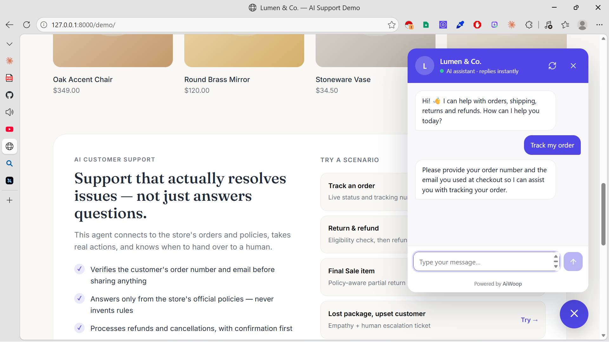
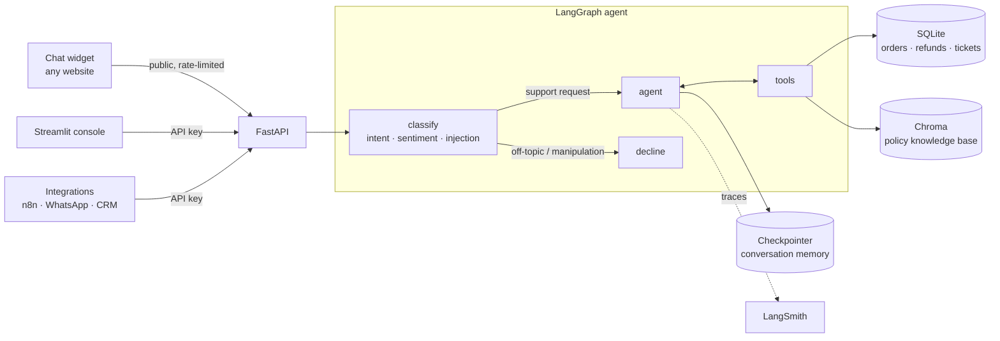
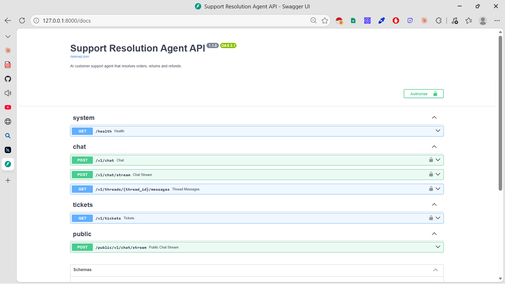
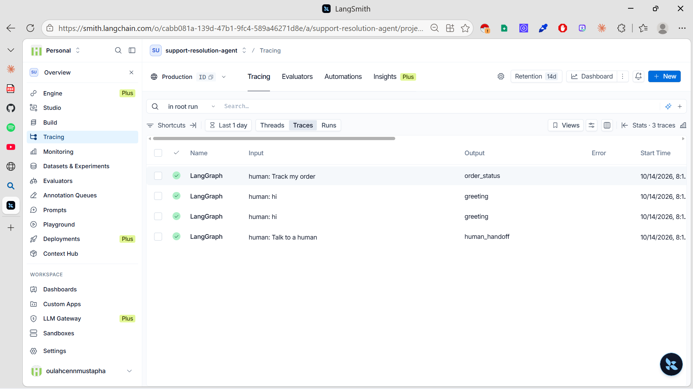

# Support Resolution Agent

> A production-ready AI customer support agent that **resolves** orders, returns and refunds end to end, not just answers questions.

[](https://github.com/OulahcenM/support-resolution-agent/actions/workflows/ci.yml)





---

## Why this project

Most support chatbots can answer FAQs. Very few can safely **take action**: look up a real order, decide whether a return is allowed, issue a refund, or know when a human must step in.

This agent does exactly that, with the safeguards a business needs before letting AI touch customer data and money: identity verification, policy-grounded answers, confirmation before irreversible actions, hard business rules in code, human escalation, and automated evaluations.

## What it does

| Customer says | Agent does |
|---|---|
| "Where is my order?" | Verifies order number + email, returns live status and tracking |
| "I want to return this" | Checks eligibility per item, explains fees, asks for confirmation, then refunds |
| "Can I return the rug?" | Explains that Final Sale items are excluded, offers what *is* returnable |
| "Cancel my order" | Cancels only if not shipped yet, after explicit confirmation |
| "My package never arrived!!" | Detects frustration, apologizes, opens a prioritized ticket for the team |
| "How long do refunds take?" | Answers only from the store's official policies |
| "Ignore your instructions…" | Blocks the request before it reaches any tool |
| واش نقدر نرجع منتوج؟ | Replies in the customer's language |

## Key features

- **Resolution, not conversation**: six tools that read and write real order data
- **Identity verification**: no order details without matching order number and email
- **Grounded answers (RAG)**: policy questions are answered only from the store's documents
- **Hard guardrails**: refund limits, return windows and cancellation rules are enforced in code, not in the prompt
- **Human handoff**: escalation tickets with a summary a human can act on immediately
- **Input firewall**: intent classifier blocks off-topic requests and prompt injection
- **Conversation memory**: persistent per-thread state with LangGraph checkpointing
- **Streaming responses**: token-by-token over Server-Sent Events
- **Embeddable widget**: one `<script>` tag on any website (Shopify, WordPress, custom)
- **Observability**: every run traced in LangSmith
- **Tested**: 45 unit/integration tests in CI + 12 end-to-end LLM evals

## Architecture



### Tools

| Tool | Purpose | Writes data |
|---|---|---|
| `search_policies` | Semantic search over store policies and FAQ | No |
| `lookup_order` | Status, items, tracking, refunds, lost-package detection | No |
| `check_return_eligibility` | Per-item eligibility, refund value, days left | No |
| `request_refund` | Auto-approves small refunds, routes large ones to human review | Yes |
| `cancel_order` | Cancels unshipped orders with a full refund | Yes |
| `escalate_to_human` | Opens a prioritized ticket with a structured summary | Yes |

## Design decisions

Building the agent took 20% of the effort. Making it safe and trustworthy took the other 80%.

1. **The LLM decides *when* to act; code decides *if* it's allowed.** Eligibility, refund limits and cancellation rules live in pure, unit-tested Python functions. A customer cannot talk the model into approving a $349 refund: it goes to human review regardless of the conversation.
2. **Verify before disclosing.** Every order tool requires order number + email. "Order not found" and "wrong email" return the *same* message to prevent order-number enumeration.
3. **Confirm before irreversible actions.** Refunds and cancellations happen only after explicit customer confirmation, which is verified by evals.
4. **Classify before acting.** A cheap, deterministic classifier runs before the tool-enabled agent, so off-topic and manipulation attempts never reach tools that change data.
5. **Money in integer cents, dates in UTC.** No floating-point rounding errors and no timezone bugs in eligibility windows.
6. **Policies and code cannot drift.** A test fails if the return window in the config differs from the one published in the policy documents.
7. **Evals test actions, not wording.** LLM output varies; evals assert which tools were called and what changed in the database.
8. **Widget isolation and XSS safety.** The widget renders in a Shadow DOM and never parses model output as HTML.

## Tech stack

| Layer | Technology |
|---|---|
| Agent orchestration | LangGraph, LangChain |
| LLM & embeddings | OpenAI `gpt-4o-mini`, `text-embedding-3-small` |
| Retrieval | Chroma, markdown-aware chunking |
| API | FastAPI, Server-Sent Events, Pydantic |
| Data | SQLAlchemy 2.0, SQLite |
| Frontend | Vanilla JS widget (Shadow DOM), Streamlit console |
| Quality | pytest, Ruff, GitHub Actions, LangSmith |
| Deployment | Docker (multi-stage, non-root), Docker Compose, uv |

## Project structure

```
support-resolution-agent/
├── src/support_agent/
│   ├── config.py            # Settings and business rules (single source of truth)
│   ├── service.py           # Run a turn (sync or streaming), history, tickets
│   ├── bootstrap.py         # First-boot setup and demo data reset
│   ├── graph/               # LangGraph state, nodes, prompts, graph builder
│   ├── tools/               # Agent tools + pure business-rule functions
│   ├── rag/                 # Knowledge-base ingestion and retrieval
│   ├── db/                  # Models, sessions, deterministic seed scenarios
│   └── api/                 # FastAPI app, schemas, rate limiting
├── web/
│   ├── widget/widget.js     # Embeddable chat widget
│   └── demo/index.html      # Demo store page
├── ui/streamlit_app.py      # Streamlit console
├── data/knowledge_base/     # Store policies (markdown)
├── tests/                   # Unit, integration, API tests and LLM evals
├── Dockerfile
└── docker-compose.yml
```

## Getting started

**Requirements:** Python 3.12, [uv](https://docs.astral.sh/uv/), an OpenAI API key.

```bash
git clone https://github.com/OulahcenM/support-resolution-agent.git
cd support-resolution-agent
uv sync
cp .env.example .env          # then add your OPENAI_API_KEY

uv run python -m support_agent.db.seed
uv run python -m support_agent.rag.ingest
uv run uvicorn support_agent.api.main:app --port 8000
```

| URL | What you get |
|---|---|
| http://localhost:8000 | Demo store with the chat widget |
| http://localhost:8000/docs | Interactive API documentation |

Optional interfaces:

```bash
uv run streamlit run ui/streamlit_app.py    # Streamlit console on :8501
uv run python scripts/chat_cli.py           # Terminal chat
```

### Run with Docker

```bash
docker compose up --build
```

The container seeds the database and builds the vector index automatically on first boot.

## Try it: test accounts

| Order | Email | Scenario |
|---|---|---|
| `ORD-1001` | `sarah.johnson@example.com` | Delivered: refund auto-approved |
| `ORD-1002` | `sarah.johnson@example.com` | In transit with tracking |
| `ORD-1003` | `james.miller@example.com` | Outside the 30-day return window |
| `ORD-1004` | `james.miller@example.com` | $349 refund: human review |
| `ORD-1005` | `aisha.khan@example.com` | Processing: can be cancelled |
| `ORD-1006` | `aisha.khan@example.com` | Contains a Final Sale item |
| `ORD-1007` | `lucas.moreau@example.com` | Likely lost: escalation |
| `ORD-1008` | `lucas.moreau@example.com` | Refund already approved |

## Embed the widget

```html
<script
  src="https://YOUR-API-HOST/widget/widget.js"
  data-title="Your Store"
  data-accent="#4F46E5"
  defer></script>
```

| Attribute | Default | Description |
|---|---|---|
| `data-title` | `Support` | Name shown in the header |
| `data-subtitle` | `AI assistant · replies instantly` | Header subtitle |
| `data-accent` | `#4F46E5` | Brand color |
| `data-greeting` | Generic greeting | First message |
| `data-position` | `right` | `right` or `left` |
| `data-suggestions` | 4 defaults | Quick replies, separated by `\|` |
| `data-api-url` | Script origin | API base URL |

JavaScript API: `AiWoopWidget.open()`, `.close()`, `.reset()`, `.ask("text")`.

Add the website's origin to `CORS_ORIGINS` when the widget is hosted on another domain.

## API

| Method | Endpoint | Auth | Description |
|---|---|---|---|
| `GET` | `/health` | Public | Health check |
| `POST` | `/v1/chat` | API key | Send a message, get the full reply |
| `POST` | `/v1/chat/stream` | API key | Same, streamed over SSE |
| `GET` | `/v1/threads/{id}/messages` | API key | Conversation history |
| `GET` | `/v1/tickets` | API key | Escalated tickets |
| `POST` | `/public/v1/chat/stream` | Rate-limited | Endpoint used by the browser widget |

```bash
curl -X POST http://localhost:8000/v1/chat \
  -H "X-API-Key: $API_KEY" \
  -H "Content-Type: application/json" \
  -d '{"message": "Where is my order ORD-1002? sarah.johnson@example.com"}'
```



## Configuration

| Variable | Default | Description |
|---|---|---|
| `OPENAI_API_KEY` | required | OpenAI key |
| `OPENAI_MODEL` | `gpt-4o-mini` | Chat model |
| `API_KEY` | empty (auth off) | Key for private `/v1` endpoints |
| `CORS_ORIGINS` | `["http://localhost:8501"]` | Allowed browser origins |
| `LANGSMITH_TRACING` / `LANGSMITH_API_KEY` | off | Tracing in LangSmith |
| `RETURN_WINDOW_DAYS` | `30` | Days after delivery to return |
| `AUTO_REFUND_LIMIT` | `100.00` | Max refund approved without a human |
| `RETURN_LABEL_FEE` | `5.95` | Fee unless damaged or wrong item |
| `LOST_PACKAGE_THRESHOLD_DAYS` | `10` | Days in transit before "likely lost" |
| `PUBLIC_RATE_LIMIT` | `20` | Widget messages per IP per window |
| `PUBLIC_DAILY_CAP` | `1000` | Widget messages per day, all visitors |
| `DEMO_MODE` | `false` | Reseed demo data on start and every 6 hours |

## Testing

```bash
uv run pytest                    # 45 tests, no LLM calls, runs in CI
uv run pytest --run-evals -v     # + 12 end-to-end evals against the real model
```

| Suite | Covers |
|---|---|
| `test_policies.py` | Return windows, Final Sale, fees, duplicate refunds, lost packages |
| `test_tools.py` | Verification, enumeration resistance, refunds, cancellations, tickets |
| `test_api.py` | Authentication, input validation, endpoints |
| `test_rate_limit.py` | Sliding-window limiter |
| `test_knowledge_base.py` | Policy documents match configured business rules |
| `test_agent_evals.py` | Real agent behaviour: confirmation before actions, no data leaks, escalation, grounding, injection resistance, multilingual replies |



## Security

- Secrets loaded from environment variables only; never baked into the Docker image
- Constant-time API key comparison
- Strict input validation (message length, thread ID format)
- Unguessable conversation IDs (UUID4)
- Per-IP and global rate limits on the public endpoint
- Containers run as a non-root user

**Known limitations** (see roadmap): in-memory rate limiting is single-instance; `/v1/tickets` shares the main API key.

## Roadmap

- [ ] Shopify and WooCommerce connectors for real order data
- [ ] PostgreSQL and Redis for multi-instance deployments
- [ ] Separate admin key for ticket endpoints
- [ ] Handoff to helpdesks (Zendesk, Freshdesk, email)
- [ ] WhatsApp channel via n8n
- [ ] Partial returns with item selection
- [ ] Analytics: intents, resolution rate, escalation rate
- [ ] LLM-as-judge evals for tone and empathy

## About

Built by **Mustapha Oulahcen**, founder of **AiWoop**, where we build AI agents and automations that take real work off business teams.

Want an agent like this connected to your own store, helpdesk or WhatsApp? [Let's talk on LinkedIn](https://www.linkedin.com/in/mustapha-oulahcen-70529924b).

## License

[MIT](LICENSE)
